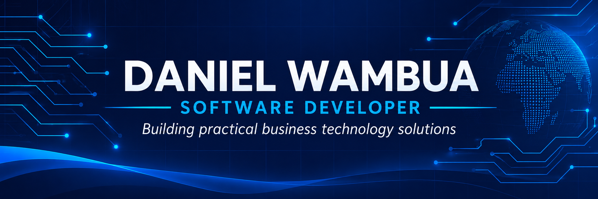

<!--
  Daniel Wambua | GitHub Profile README
  GitHub: Dantez21
-->

# Daniel Wambua

### SOFTWARE DEVELOPER

**Building practical business technology solutions.**

---

## 👋 About Me

I am a Software Developer transitioning into professional software engineering, with a strong interest in building reliable, scalable, and practical technology solutions.

My interests span frontend development, backend engineering, database design, enterprise resource planning, and business process automation.

I enjoy understanding real business challenges and translating them into functional software systems.

- 🔭 Building real-world business and enterprise applications.
- 🌱 Deepening my knowledge of Python, FastAPI, React, TypeScript, and software engineering.
- 🏗️ Exploring ERP systems, system architecture, API development, and database management.
- 🔗 Exploring blockchain applications in supply chain transparency and traceability.
- 🤝 Interested in software collaboration and open-source development.
- 📍 Kenya 🇰🇪

## 🚀 What I'm Building

### 🥩 PEAK TRACE — Beef Supply Chain Traceability

A farm-to-table beef traceability platform designed to connect livestock records, animal health, slaughter, carcass processing, packaging, distribution, and consumer QR verification.

**Technologies:** React · TypeScript · Python · FastAPI · PostgreSQL

### 📊 BizNuru — Business Intelligence

A business intelligence and management platform focused on helping small and medium-sized enterprises understand their business performance and make informed decisions.

**Technologies:** React · TypeScript · Python · FastAPI · PostgreSQL

### 🏢 ERPNext / Frappe Development

Exploring enterprise application development, ERP customization, business workflows, database models, and open-source contributions.

**Technologies:** Python · Frappe Framework · ERPNext · JavaScript · MariaDB

---

## 🛠️ Technical Skills

### Frontend Development

### Backend Development

### Databases

### Development Tools & Platforms

---

## 📌 Selected Public Repositories

| Project | Description | Repository |
|---|---|---|
| University Website | University website project | [View](https://github.com/Dantez21/university-website-v1) |
| CodeMentor AI | Interactive coding assistant | [View](https://github.com/Dantez21/CodeMentor-AI) |
| Service Booking System | Service booking application | [View](https://github.com/Dantez21/Service-Booking-System) |

For more projects, visit [my GitHub repositories](https://github.com/Dantez21?tab=repositories).

---

## 📊 GitHub Statistics

  

   

  

 

## 🔥 Contribution Streak

## 📈 Contribution Activity

  

---

## 🤝 Let's Connect

I am interested in connecting with developers, technology professionals, businesses, and organizations working on meaningful software solutions.

Whether it's software development, enterprise systems, business automation, or collaborative projects, I welcome opportunities to learn, contribute, and build.

**"Building solutions. Solving problems. Creating impact through technology."**

